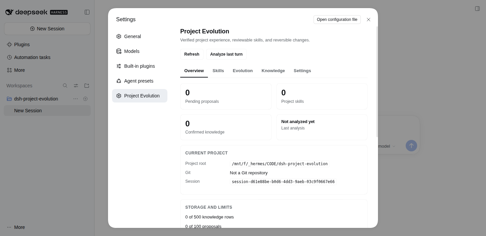
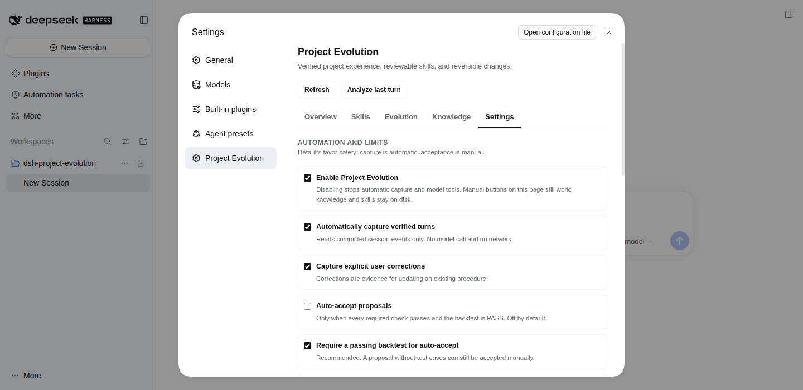
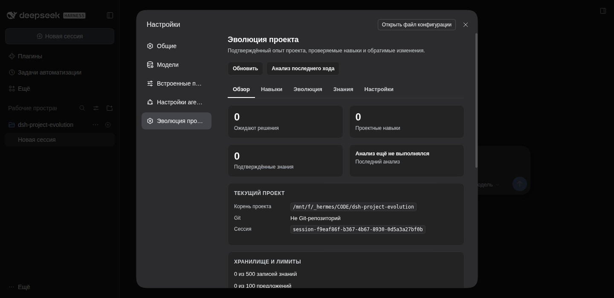

# Project Evolution for DeepSeek Harness

Project Evolution turns **verified project work** into knowledge and reusable
skills without turning a project into a pile of unreviewed `SKILL.md` files.

It is a native DSH plugin bundle:

- host half: project detection, evidence capture, knowledge store, proposal
  review, version history, rollback, two model tools plus two read/record tools;
- Web half: a **Settings → Project Evolution** section with Overview, Skills,
  Evolution, Knowledge, and Settings tabs;
- ordinary project skills at `<project>/.dsh/skills/<name>/SKILL.md`, discovered
  by DSH's native skill loader and tracked by Git like any other project file.

No external service, no telemetry, and **no model call** are made by the plugin.

## Requirements

- DeepSeek Harness `0.2.2-rc.1` (the version this bundle was built and tested
  against)
- Node.js 22+
- A session opened in a project directory; Git is recommended but optional

## Install

### From the prebuilt GitHub release (recommended)

The release tarball is built from the tagged source; no install-time build
scripts are involved:

```bash
dsh plugin --profile <profile> add \
  https://github.com/triagmas/dsh-project-evolution/releases/latest/download/dsh-project-evolution.tgz
```

### From the GitHub source

```bash
dsh plugin --profile <profile> add github:triagmas/dsh-project-evolution
```

### From a local checkout

Build and pack first, then install the resulting tarball (or point Plugin
Manager at the tarball):

```bash
npm pack
dsh plugin --profile <profile> add ./dsh-project-evolution-1.0.1.tgz
```

Enable the **Project Evolution** bundle after installation and reload the Web
UI. The host registers the routes, tools, prompt section, and turn observer on
the next session start. A fresh session is required for the model tools to
appear in its tool list.

This repository does **not** modify an active profile by itself. Installation
into a live profile changes every session in that profile and must be confirmed
by the user. Nothing is committed or pushed by the plugin. See [SECURITY.md](SECURITY.md)
for the public-release security policy and the checks performed on this tree.

## Quick acceptance scenario

1. Open a session in a project with no project skills.
2. Run a real task, change a file, and execute a real verification command
   (for example `npm test`) whose output says it passed.
3. End the turn. Project Evolution records masked evidence. A turn that
   changed at least one file, or contains an explicit user correction, creates
   a reviewable proposal; a read-only verification is captured as knowledge
   only. It never writes the skill.
4. Open **Settings → Project Evolution → Evolution**, inspect the diff, checks,
   and evidence replay, then **Accept**.
5. The skill appears at `.dsh/skills/<name>/SKILL.md`. A new DSH dialog in the
   same project discovers it through the native skill catalog, and
   `project_evolution_recall` ranks it for matching tasks.
6. Correct the agent in a later turn. The correction updates the *existing*
   procedure as a new reviewable version rather than creating a duplicate.
7. Compare versions/diffs, test **Roll back**, and confirm another project has
   no access to this project's knowledge or skills.

`npm run acceptance` runs this scenario against two temporary Git projects and
prints PASS/FAIL evidence; it never installs into a profile.

## What is verified, and what is not

Evidence capture is deterministic. The plugin parses the real DSH session event
stream (`turn/start`, `user/message`, `assistant/message`, `tool/call`,
`tool/result`, `turn/end`). It never executes a captured command.

A **backtest** is an evidence replay: it checks that the candidate skill
contains the command, file, correction, and verification facts that were
actually observed. It is not a model-quality benchmark and is not a claim that
the skill will improve an unrelated task. Reports use `PASS`, `FAIL`, or
`Not tested`; an unbacktested proposal cannot be auto-accepted.

## Settings tabs



- **Overview** — project root, Git state, counts, limits, recent runs, and how
  capture works.
- **Skills** — project skills with content editor, proposal-based updates,
  version history, rollback, enable/disable, archive, and explicit global
  publication. Global skills are read-only here.
- **Evolution** — proposals with reason, evidence score, checks, deterministic
  backtest, diff, accept/reject. Accepting is the only path that writes a skill.
- **Knowledge** — searchable, project-isolated decisions/pitfalls/corrections;
  add a note or delete a row. Captured text is shown as untrusted evidence.
- **Settings** — auto-analyze, auto-accept (off by default), evidence threshold,
  capture interval, daily budgets, storage limits, retention, corrections, and
  global publication permission.



The UI is localized in English (default) and Russian, follows the DSH light/dark
theme tokens, and is responsive at narrow widths.



## Data layout

Per project (Git-ignored evidence):

```text
<project>/.dsh/project-evolution/
  state.json          bounded counters and per-session cursors
  knowledge.jsonl     append-only evidence, deduplicated by fingerprint
  proposals/          reviewable proposal records (never skill files)
  versions/<name>/    content-addressed versions and diffs
  runs/               apply/rollback/publish/archive audit runs
  archive/            archived skills, moved out of the native skill tree
  .gitignore          ignores the evidence directory
```

Project skills are ordinary files:

```text
<project>/.dsh/skills/<name>/SKILL.md
```

Global configuration:

```text
$DSH_HOME/project-evolution/config.json
```

The global skill root (`$DSH_HOME/skills`) is only touched by an explicit
publish action with confirmation; global publication is disabled by default.

## Model tools

The model can discover and propose, never accept or mutate:

| Tool | Purpose |
| --- | --- |
| `project_evolution_status` | Current project, skills, pending proposals, limits, runs |
| `project_evolution_recall` | Matching project skills and untrusted knowledge |
| `project_evolution_propose` | Create a reviewable proposal from the last turn or a draft |
| `project_evolution_record` | Record one explicit decision/pitfall/correction/fact |

There is intentionally no model tool for accept, rollback, publish, archive, or
editing. Those are user actions in the Web UI.

## Configuration defaults

```json
{
  "enabled": true,
  "autoAnalyze": true,
  "autoAccept": false,
  "analyzeIntervalMinutes": 5,
  "maxAnalysesPerDay": 48,
  "maxModelCallsPerDay": 0,
  "maxInputChars": 24000,
  "maxKnowledgeEntries": 500,
  "maxProposals": 100,
  "retentionDays": 90,
  "minEvidenceScore": 5,
  "captureUserCorrections": true,
  "requireTestsForAutoAccept": true,
  "globalPublishAllowed": false
}
```

`maxModelCallsPerDay` is reserved and unused: this version makes zero model
calls. Automatic acceptance, when explicitly enabled, applies only to the
automatic verified capture path with `tests.status === "PASS"` and measurable
improvement. Analyze, model proposals, and manual edits always wait for review.

## Safe auto-improvement: prerequisites

Only consider auto-accept when all of the following are true:

1. the project is in Git and the task is reproducible;
2. the verification command is real and its output is captured;
3. the deterministic backtest passes and the candidate improves the baseline;
4. `requireTestsForAutoAccept` remains enabled;
5. the skill is project-scoped, not globally published;
6. the user has reviewed the first several versions and accepts the residual
   risk of an incorrect procedure being loaded automatically.

Even then, rollback and version history remain the safety net. Auto-accept is
not a substitute for review on safety-critical projects.

## Compatibility with other installed plugins

- **`superpowers-dsh`** — this bundle does not wrap or modify its skill provider;
  it lists other providers' skills as read-only global catalog entries.
- **`dsh-skill-manage`** — that plugin's `skill_manage` tool remains the
  general-purpose editor. Project Evolution does not register a competing
  `skill_manage`, and it uses the same project/user scope conventions.
- **`@michengai/dsh-skills-manager`** — its library, trash, routes, and UI are
  untouched. Project Evolution uses a separate `/api/project-evolution` route
  namespace and a separate `settings.section` id.
- No compatibility check is disabled, and no installed plugin's files are
  modified.

See [docs/architecture.md](docs/architecture.md) for APIs, module boundaries,
and lifecycle, [docs/security.md](docs/security.md) for the threat model, and
[docs/acceptance.md](docs/acceptance.md) for reproducible evidence.

## Development

```bash
npm test              # node --test test/unit.test.js test/integration.test.js test/client.test.js
npm run smoke         # one temporary project, proposal + accept
npm run acceptance    # full two-project acceptance scenario
node --check index.js && node --check client.js
```

## Limitations (honest)

- The analyzer is rule-based, not an LLM. It recognizes common task/correction
  and test-output shapes; unusual phrasing can produce no proposal.
- Evidence replay verifies artifacts, not semantic quality or future model
  behavior.
- Global publishing copies one skill; it does not synchronize later project
  updates, and it never runs `git push`.
- More than 20 versions per skill are pruned (newest kept); proposal retention
  and knowledge caps are configurable but bounded.
- A skill's effect on future sessions is measured only by the observable
  proposal/accept/rollback runs, not by a causal A/B benchmark.
- `AGENTS.md` remains user-owned. Project Evolution does not rewrite it; use it
  for project-specific expectations if you already have one. The plugin adds a
  short system-prompt discipline section and native project skills instead.

## License

MIT. See [LICENSE](LICENSE).
